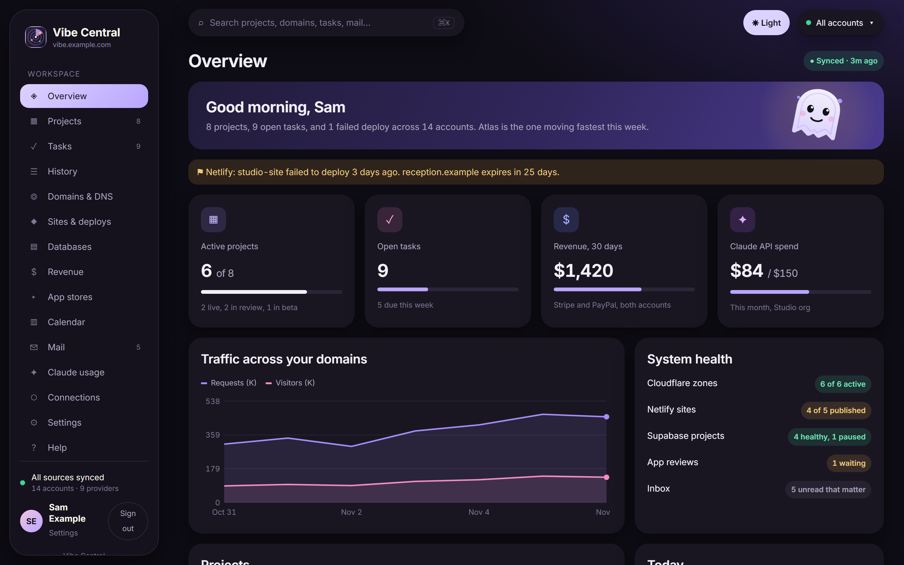
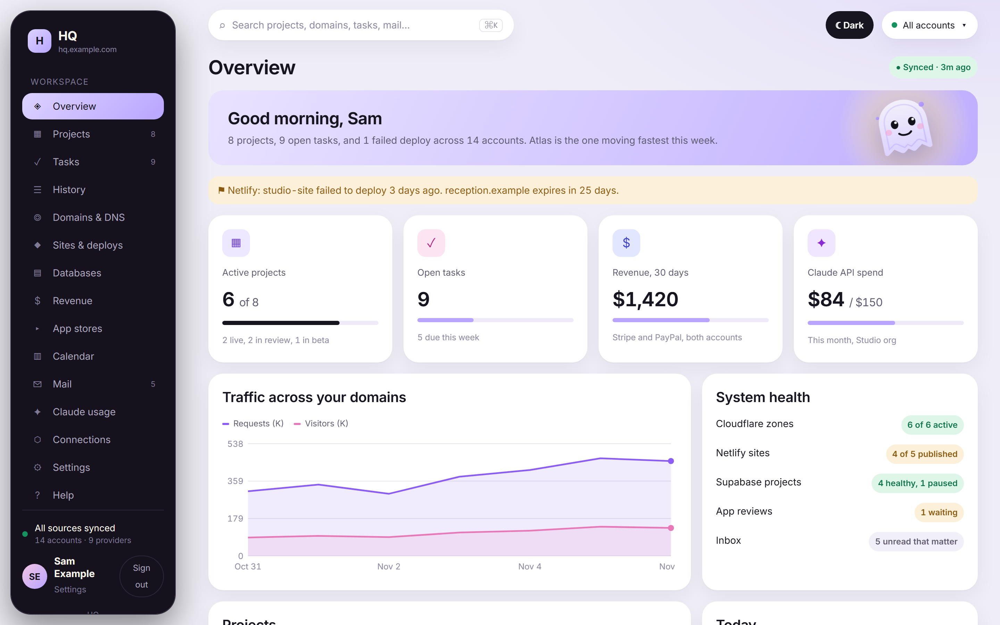
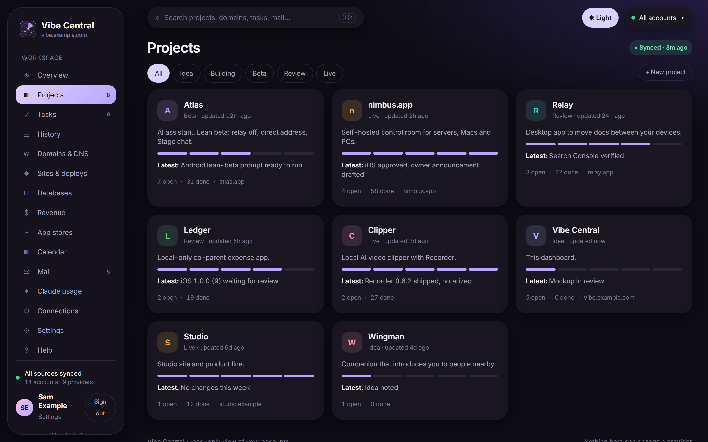
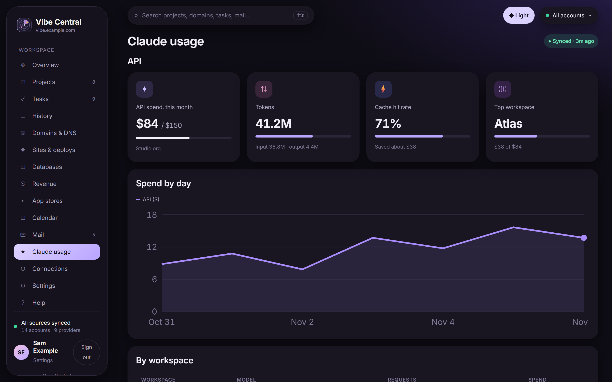
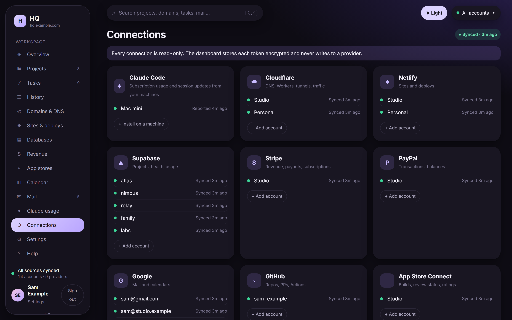
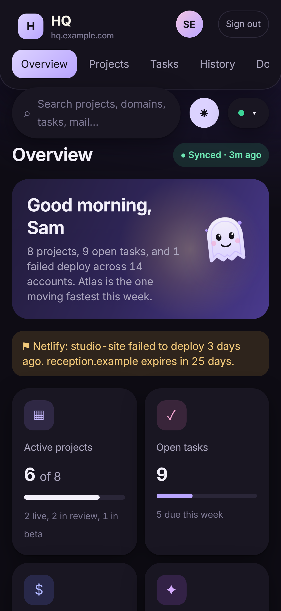

<p align="center">
  <picture>
    <source media="(prefers-color-scheme: light)" srcset="assets/brand/vibecentral-logo-light.svg">
    
  </picture>
</p>

# Vibe Central

One read-only dashboard for everything you run: domains, sites, databases, revenue, app stores, mail, calendar, GitHub, Claude API spend, and what Claude Code did today. Self-hosted on your own free tiers. One user, by design.



<details>
<summary>More screenshots</summary>

Overview, light:



Projects with stages, tasks and history:



Claude usage: API spend and Claude Code tokens by project, model and machine:



Connections:



Phone layout:



</details>

## What it is

- **Single user.** Google sign-in only. The first Google account to sign in becomes the owner, or you pre-set an allow-list. No passwords, no sign-up page, no roles.
- **Self-hosted.** Runs on a Cloudflare Worker, a Supabase project and (optionally) Resend, all on their free plans and all in your own accounts. Nothing is hosted by the author. No telemetry.
- **Read-only.** Every connector calls GET endpoints. The handful of exceptions (OAuth token exchanges, one read-only GraphQL analytics query, three fixed SELECT statements) are listed in [docs/PROVIDERS.md](docs/PROVIDERS.md). Vibe Central cannot deploy, delete, charge or change anything on a provider.
- **A snapshot.** Each account is synced every 5 minutes by default. The providers remain the source of truth.

## What it is not

- Not multi-tenant. You cannot host it for a team or for customers.
- Not an admin console. There are no buttons that act on providers.
- Not a monitoring system. There are a few alert emails, not uptime checks or paging.

## Claude Code

This is the part you will not find elsewhere. Vibe Central shows what Claude Code did on each of your machines, per project.

- **Sessions.** A `SessionEnd` hook posts a one-line summary plus "done" and "open" task lists for each session. The folder name is mapped to a project; unknown folders land in an **Unsorted** bucket where one click maps them. Done items tick off matching tasks, open items become tasks. Project history shows sessions next to deploys, PRs and review state changes.
- **Usage.** A small agent runs every 15 minutes, reads the token counts Claude Code already records in its local transcripts, and sends totals by day, project, model and machine: input, output, cache read, cache write. This covers your Claude subscription usage, which no API exposes.
- **Install** is one line per machine, copied from Connections → Claude Code → Install. The dashboard serves the scripts itself at `/agent/install.sh` and `/agent/install.ps1`. Windows, macOS and Linux; Node 18 or newer; no dependencies.
- **Privacy.** Only counts and the folder name leave the machine. Never prompts, code, tool calls, file paths or diffs. The hook reads only the last assistant message of a session, and only the optional `HQ:` block or its first sentence. The ingest key is write-only.
- **The `HQ:` block.** An optional snippet in your global `CLAUDE.md` asks Claude to end a working session with `summary`, `done` and `open` lines. With it, the session log and the task lists are accurate. Without it, the first sentence of the last message is used.
- **Plan limits are deliberately not shown.** The 5-hour and weekly percentages are not available through any supported API, and scraping claude.ai is not something a background agent should do.

Details, test commands and the exact payloads: [docs/CLAUDE-CODE-SETUP.md](docs/CLAUDE-CODE-SETUP.md).

## Install in 5 minutes

You need: a Cloudflare account, a Supabase account with a new empty project, a Google Cloud OAuth client (for sign-in; steps in [docs/PROVIDERS.md](docs/PROVIDERS.md#google-gmail-and-calendar)), Node 24.

```bash
git clone https://github.com/vaxman14/vibecentral && cd hq && npm install && npm run setup
```

Windows PowerShell: `node scripts/setup.mjs` instead of `npm run setup`, because `npm.ps1` is blocked by the default execution policy. Git Bash works as written.

The wizard logs you into Cloudflare and Supabase, asks for the Supabase service key, an app name and an optional domain (workers.dev works), takes the Google and Resend keys if you have them, pushes the schema, deploys the sync function and the Worker, loads the secrets and prints your URL. Open it, sign in with Google, add connections.

Or start with the button:

[](https://deploy.workers.cloudflare.com/?url=https://github.com/vaxman14/vibecentral)

The button does only the Worker half: it forks the repo, creates the Worker and sets up deploys on push. It does not create the database, deploy the sync function or set the secrets. Afterwards clone your fork and run `npm run setup` there; the wizard is re-run safe and lets you skip the Worker step it finds already done. Every step, by hand, is in [docs/DEPLOY.md](docs/DEPLOY.md).

Keys you skip during setup (Google client, Resend) can be pasted later under Settings → Setup keys.

## What it connects to

| Provider | What is read | Caveat |
|---|---|---|
| Cloudflare | Zones, DNS record counts, 7-day traffic and threats, Workers, tunnels, Registrar renewals | Scoped read-only token. Expiry only for domains on Cloudflare Registrar |
| Netlify | Sites, deploys with state and build time | Netlify tokens cannot be scoped; the token acts as you, Vibe Central only calls GET |
| Supabase | Projects, health, database size, auth users, advisors | Management tokens cannot be scoped. Size and users via three fixed SELECTs. Free projects pause after a week idle (the cron keeps Vibe Central's own project awake, not yours) |
| Stripe | 30-day revenue, subscriptions, balance, next payout | Restricted key with Read permissions only |
| PayPal | Balances, 31 days of transactions | App with Transaction Search enabled; data lags a few hours |
| Google | Gmail headers and snippets, Calendar events | Read-only scopes. Needs your own Google Cloud OAuth client. Message bodies are never fetched |
| GitHub | Repos, open and recent PRs, Actions runs | Fine-grained token, read-only. Owned repos only |
| App Store Connect | Apps, versions, review state, latest build, TestFlight | No aggregate rating; the API does not have one |
| Google Play | Ratings, installs, crashes from the reports bucket, reviews | No release status: reading it needs a write call, which Vibe Central will not make |
| Anthropic | API usage and cost by workspace and model | Admin keys cannot be scoped. Optional; skip it if that bothers you |

Exact token click paths, permissions, endpoints and gaps per provider: [docs/PROVIDERS.md](docs/PROVIDERS.md).

## Also in the box

- **Projects** with stages (Idea, Building, Beta, Review, Live), tasks, and a history timeline fed by typed updates, Claude Code sessions and events from linked domains, sites, databases, apps and repos.
- **Alerts** by email with dedupe and quiet hours: failed deploy, domain expiring within 30 days, app review state change, token failure, and optional new revenue and new build.
- Command palette (Ctrl/Cmd+K), account switcher, light and dark, phone layout.
- Settings → Data: JSON export (no tokens), clear cache, delete everything.

## Security model

- **Tokens at rest.** Provider tokens are encrypted with AES-256-GCM under a master key that lives only as a Worker and Edge Function secret. They are decrypted inside the sync function, never returned by the API, never logged.
- **Least scope where the provider allows it.** Cloudflare, Stripe, GitHub and Google tokens are scoped read-only. Netlify, Supabase and Anthropic do not offer scoped tokens; the docs say so plainly and the code only calls read endpoints.
- **No writes.** GET only, except token exchanges, Cloudflare's read-only GraphQL analytics POST, and Supabase's SQL endpoint with three constant SELECT statements. The complete list is in [docs/PROVIDERS.md](docs/PROVIDERS.md) and `supabase/functions/sync/README.md`.
- **Sign-in.** Google only, allow-list or first-sign-in-wins. Sessions last 30 days in an HttpOnly, Secure, SameSite cookie. "Sign out others" ends every other session.
- **Ingest key.** The Claude Code hook and agent hold one key that can only write session and usage rows. It cannot read anything.
- **No telemetry.** Vibe Central never calls a server you do not run. There is no update check.
- **Delete everything.** Settings → Data → Delete everything removes every row including tokens and signs you out. Your providers are untouched; revoke the tokens there if you want to be thorough.

## FAQ

**Can I host it for other people?**
No, by design. One owner, one Google account (or a short allow-list of your own addresses). There is no tenant model and no plan to add one. Each person runs their own copy.

**Does it write anything to my accounts?**
No. See the security model above. The exceptions are token exchanges and two read-only POSTs, documented with the reason for each.

**What does it cost?**
$0 on the free plans of Cloudflare Workers, Supabase and Resend. The Worker's one-minute cron and the sync function's 150-second budget fit the free limits. Workers Paid is not needed. A custom domain is optional.

**Why Google sign-in only?**
Because you probably connect Gmail anyway, and one well-tested OAuth flow is safer than a password form. There is no password to leak or reset.

**Why does my Supabase project keep pausing?**
Free Supabase projects pause after a week without activity. Vibe Central's own project stays active because the cron calls it every minute. Your other projects are listed with status Paused when that happens; Vibe Central cannot and will not unpause them.

**Can it show my Claude plan limits?**
No. See the Claude Code section.

**Where does the data live?**
In your Supabase project. Export it as JSON from Settings → Data at any time.

## Documentation

- [docs/DEPLOY.md](docs/DEPLOY.md): every command the wizard runs, environment variables, test checklist.
- [docs/PROVIDERS.md](docs/PROVIDERS.md): per provider, which token, which permissions, what is read, known gaps.
- [docs/CLAUDE-CODE-SETUP.md](docs/CLAUDE-CODE-SETUP.md): the hook, the agent, the `HQ:` block, what is sent, uninstall.
- [docs/API.md](docs/API.md): the Worker's API contract.
- [supabase/functions/sync/README.md](supabase/functions/sync/README.md): how the sync works, alerts, non-GET calls.
- [CONTRIBUTING.md](CONTRIBUTING.md): running locally with sample data, type checks, ground rules.

## License and credits

MIT, copyright 2026 Roman Vaxman. See [LICENSE](LICENSE).

Design: the bananana V18 tokens by the author. Built with Hono, Vite, Supabase and Cloudflare Workers.
